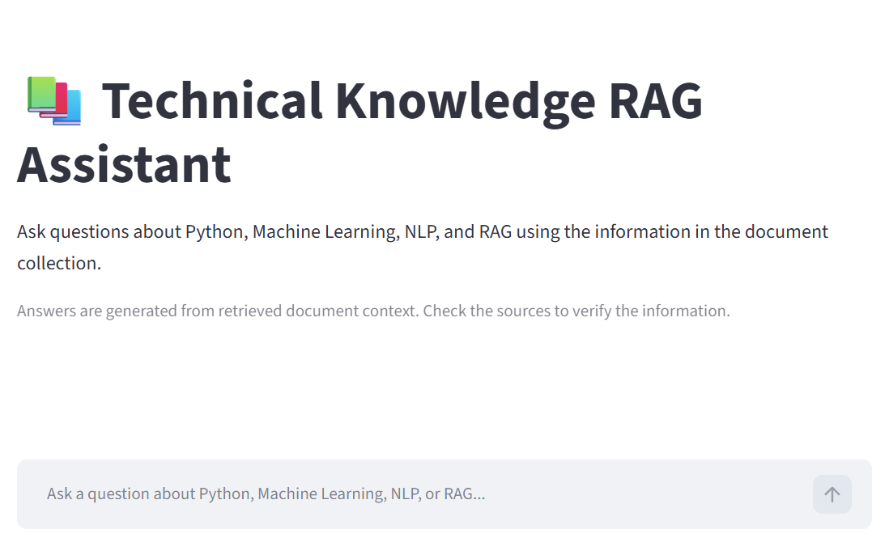
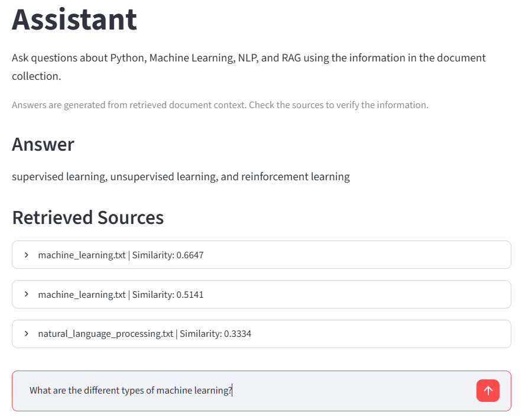
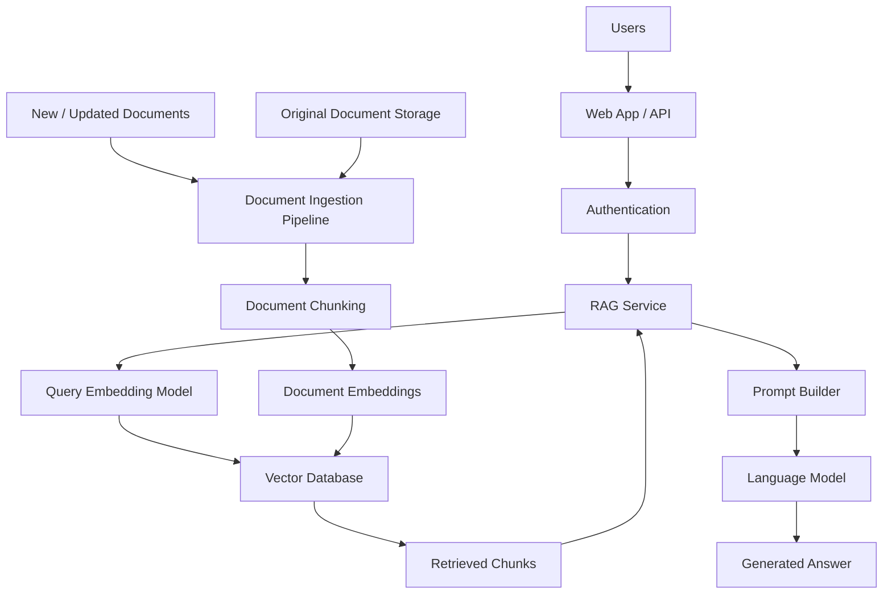

# Technical Knowledge RAG Assistant

A beginner-friendly Retrieval-Augmented Generation (RAG) system built in Python.

The project retrieves relevant information from a custom document collection and provides that information to a local language model to generate an answer.

## Project Overview

This project demonstrates the main components of a basic RAG pipeline:

1. Document loading
2. Text chunking
3. Text embeddings
4. Vector storage
5. Similarity retrieval
6. Context-based answer generation

The main RAG pipeline uses FAISS for vector search and FLAN-T5 for local answer generation. ChromaDB is also implemented as an alternative vector-store approach.

## Live Demo

Try the application here: [Open Technical Knowledge RAG Assistant](https://jvcespecwspngmbs2zc47u.streamlit.app/)

The application retrieves relevant information from custom documents and generates answers using a language model.

## Screenshots

### Application Interface

## Screenshots

<p align="center">
  <strong>Application Interface</strong><br><br>
  
</p>

<br>

<p align="center">
  <strong>RAG Answer and Retrieved Sources</strong><br><br>
  
</p>

## Architecture

### Basic RAG Pipeline

```text
Custom Documents
       |
       v
Document Loader
       |
       v
Text Chunking
       |
       v
Embedding Model
       |
       v
Vector Store
(FAISS / ChromaDB)
       |
       v
User Question
       |
       v
Question Embedding
       |
       v
Similarity Search
       |
       v
Top Relevant Chunks
       |
       v
Context + Question
       |
       v
Language Model
       |
       v
Generated Answer
```

## Technologies Used

* Python
* Sentence Transformers
* FAISS
* ChromaDB
* Hugging Face Transformers
* FLAN-T5
* NumPy

## How RAG Works

Retrieval-Augmented Generation combines information retrieval with language generation.

First, documents are divided into smaller chunks.

Each chunk is converted into an embedding, which is a numerical representation of its semantic meaning.

The embeddings are stored in a vector store.

When the user asks a question, the question is also converted into an embedding.

The system searches for chunks that are semantically similar to the question.

The most relevant chunks are then passed to the language model as context.

The language model uses this context to generate the final answer.

## Embeddings

This project uses the `all-MiniLM-L6-v2` Sentence Transformer model.

The model converts text into 384-dimensional vectors.

These vectors allow the system to perform semantic similarity searches.

## Chunking Strategies

### 1. Fixed-Size Word Chunking

The first strategy divides text according to a fixed number of words.

This implementation uses:

* 80 words per chunk
* 15-word overlap

The overlap helps preserve information that appears near chunk boundaries.

**Advantages:**

* Simple to implement
* Predictable chunk size
* Easy to control

**Disadvantages:**

* May split related information between chunks
* Does not consider sentence boundaries

### 2. Sentence-Based Chunking

The second strategy divides documents into groups of complete sentences.

The current implementation groups three sentences per chunk.

**Advantages:**

* Preserves complete sentences
* Better maintains natural language context
* Easier to understand semantically

**Disadvantages:**

* Chunk sizes can vary
* Long sentences can produce larger chunks
* Less predictable than fixed-size chunking

## FAISS vs ChromaDB

### FAISS

FAISS is a vector similarity search library designed for efficient search over embeddings.

In this project, FAISS stores the embeddings in an index and retrieves the most similar vectors. The main RAG assistant currently uses FAISS.

### ChromaDB

ChromaDB is a vector database designed for storing and querying embeddings together with document information and metadata.

In this project, ChromaDB provides persistent local storage for the document chunks and their embeddings and is used to demonstrate an alternative vector-store approach.

### Main Difference

FAISS is primarily focused on high-performance vector similarity search.

ChromaDB provides a higher-level database experience with collections, documents, embeddings, and metadata.

For a small standalone retrieval system, FAISS is simple and lightweight.

For applications that need more database-style organization and metadata management, ChromaDB can be more convenient.

## Scalable Production RAG Architecture

A production RAG system can be expanded into the following architecture:



### Production Components

**API / Web App**
Receives questions from users.

**Authentication**
Controls access to the application and private documents.

**RAG Service**
Coordinates retrieval, context creation, and generation.

**Embedding Service**
Converts questions and document chunks into vectors.

**Vector Database**
Stores embeddings and retrieves semantically similar information.

**Document Storage**
Stores original documents.

**Ingestion Pipeline**
Processes new documents, creates chunks, generates embeddings, and updates the vector database.

**Language Model**
Generates the final response using retrieved context.

## Running the Project

### 1. Install dependencies

```bash
pip install -r requirements.txt
```

### 2. Test document loading

```bash
python src/loader.py
```

### 3. Test chunking

```bash
python src/chunker.py
```

### 4. Test embeddings

```bash
python src/embeddings.py
```

### 5. Test FAISS

```bash
python src/vector_store.py
```

### 6. Test ChromaDB

```bash
python src/chroma_store.py
```

### 7. Run the RAG assistant

```bash
python src/main.py
```

### 8. Run the tests

```bash
python -m unittest discover -s tests -v
```

## Example Questions

```text
What is machine learning?

What is NLP?

What is RAG?

What libraries are commonly used in Python?
```

## Example

```text
Question: What is RAG?

Answer: An approach that combines information retrieval with language generation.

Retrieved sources:
- rag.txt
```

## Limitations

This is a beginner-level local RAG implementation.

The language model and vector stores run locally.

The document collection is small and consists of a few custom text files.

The current RAG assistant uses FAISS for retrieval, while ChromaDB is included as an alternative implementation.

A production system would require additional considerations such as scalability, monitoring, security, better document processing, and more advanced retrieval techniques.
